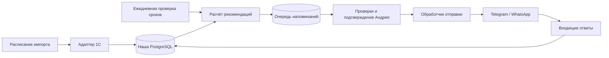

# Как запускается работа

## Реализовано

1. `POST /api/v1/imports/visits` → `VisitImportService` → транзакция PostgreSQL.
2. `GET /api/v1/recommendations` → `RecommendationService` → `RecommendationStrategy` → предварительный результат.
3. `GET /api/v1/integrations/telegram/status` → `TelegramService` → адаптер → Telegram `getMe`.
4. `POST /api/v1/integrations/telegram/test-message` → адаптер → Telegram `sendMessage`.

Spring Data Repository отделяет работу с данными. Strategy позволяет заменить правило
прогноза, не меняя контроллер. Gateway/Adapter отделяет Telegram от сценария приложения.
Зависимости внедряются конструктором. Контроллеры не содержат правил ТО.
Микросервисы, брокер сообщений и ML в первой версии не нужны.

## Следующая итерация: три независимых процесса

Предлагаемое расписание, пока не реализованное: импорт изменений раз в час,
расчёт сроков ежедневно в 10:00 по часовому поясу сервиса, обработка очереди раз в минуту.
Время наступает независимо от новых визитов, поэтому нужен отдельный ежедневный расчёт.

Импорт сначала работает с выгрузкой, затем с согласованным read-only интерфейсом 1С.
Не писать в мастер, не подключаться произвольными SQL-запросами к внутренним таблицам 1С.
Сохранять время успешной синхронизации; при устаревших данных отправку останавливать.
Учитывать исправления и отмены, брать перекрывающийся интервал изменений.

Расчёт создаёт pending-напоминание с причиной, версией правила и датой следующего ТО.
На уровне БД уникальность цикла: клиент + машина + вид работ + исходное последнее ТО.
Нельзя включать дату ежедневного запуска в ключ — это создаст ежедневные дубли.
После исправлений данных существующую рекомендацию пересчитать, после нового ТО отменить.

Перед отправкой заново проверить согласие, актуальность данных, новый визит/запись,
отписку, ограничения частоты и подтверждение мастера. Состояния очереди и результат попыток
хранить в PostgreSQL; захват заданий делать транзакционно, с блокировкой и сроком аренды.
При неясном результате сетевой отправки возможен дубль: Telegram sendMessage не даёт нам
автоматической гарантии exactly-once. Такие попытки требуют отдельного статуса и политики повторов.

Входящие Telegram updates локально удобнее получать polling, на сервере — webhook.
Сохранять обработанные update_id; связывать chat_id с клиентом через одноразовый код,
а не по имени или открытому customerId. `/start` сам по себе не подтверждает личность владельца машины.
Фиксировать явное согласие на напоминания и поддерживать `/stop`.

## Что меняем после получения данных

Нужны версия/конфигурация 1С, формат документов и их стабильные идентификаторы,
признаки закрытия/отмены, список работ, пробег, клиент, автомобиль и даты изменений.
Неизвестные услуги нельзя молча считать ТО. Названия услуг нормализуем через явную таблицу соответствий.
Первые данные — обезличенный образец; реальные дампы и секреты не помещаем в Git.

Пока рекомендации читают историю целиком. Для локального пилота это приемлемо;
перед большой базой добавить выборку по автомобилям, пакетный расчёт и таблицу результатов.
Исторический asOf исключает будущие даты визитов, но не восстанавливает прежние редакции документов.
